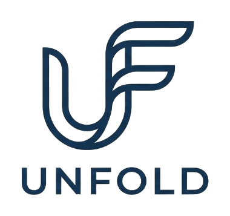

# UnFold



Student wellbeing reflection and counselor preparation, combining a tabular gradient-boosting model, a local RoBERTa journal model, and optional Google Gemini guidance. Academic project, Department of Computer Science & Engineering, MANIT Bhopal.

## Run Locally

Use Python 3.11-3.13. Run commands from the repository root.

```bash
git lfs install
git lfs pull
python3 -m venv .venv
source .venv/bin/activate
python -m pip install -r requirements.txt
streamlit run app/app.py
```

On Windows, activate with `.venv\Scripts\Activate.ps1` instead. Open http://localhost:8501.

The model files must exist at `models/depression_model.pkl` and `models/roberta_mental_health/`. The transformer weights use Git LFS. Inference loads these artifacts locally without downloading another model. The scikit-learn version is pinned to match the saved estimator.

## Assessment Workspace

- A blank, optional journal and a compact student profile. With no journal, only the profile score is used.
- Complete demo scenarios load both the profile and reflection without submitting or enabling online AI.
- One submitted snapshot contains the inputs, model outputs, guidance, checklist, and prepared report. Editing inputs marks the result as out of date.
- Student view emphasizes reflection and next steps. Counselor view adds submitted inputs, intake notes, model evidence, and PDF export.
- Action checkboxes persist within the current assessment. Navigation, checklist changes, and downloads do not repeat inference or online guidance calls.
- Clear removes the session's inputs, snapshot, action selections, and prepared PDF.

## Privacy and Optional Online Guidance

Local guidance is the default. The application holds student inputs, results, and prepared PDF bytes in the browser's server session; it does not automatically write new counselor reports to disk or maintain an assessment database. Previously generated files under `reports/` are not deleted by this update. Server operators still control the hosting environment.

To make online guidance available, configure `GEMINI_API_KEY` in the server environment, a local ignored `.env`, or Streamlit Cloud secrets. Never commit credentials. Streamlit secrets take precedence over environment/.env values.

The default model is `gemini-3.5-flash-lite`, with `gemini-3.1-flash-lite` as a fallback. Set `GEMINI_MODEL` and `GEMINI_FALLBACK_MODEL` to supported models available to your API project. Set the fallback to `none` to disable it. For example, these non-secret settings can be added alongside your existing key in Streamlit secrets:

```toml
GEMINI_MODEL = "gemini-3.5-flash-lite"
GEMINI_FALLBACK_MODEL = "gemini-3.1-flash-lite"
```

For HTTP 500/502/503/504, the SDK retries once with a short backoff. If the selected model remains unavailable, is not found (404), or times out, the app tries the configured fallback. There are at most two attempts per model, a 15-second per-request timeout, and at most two distinct models per submission. Authentication, quota, and invalid-request errors do not trigger a retry or model switch. Model access and capacity are not guaranteed; if the allowed attempts fail, the app returns local guidance. This may mean up to four Google requests for one opted-in assessment.

When online guidance fails, the assessment displays a fixed, credential-free explanation for quota/rate limits, authentication/access, model availability, request configuration, timeouts, provider outages, or invalid responses. Server logs contain only an error category, HTTP status, model identifier, and exception type. A valid key does not guarantee model access or available quota. After changing cloud secrets, reboot the app if needed and submit a new assessment: existing session snapshots retain their previous guidance result.

An API key alone does **not** enable online processing. The user must enable **Use online AI guidance** for the submission. That choice permits sending the profile, reflection, model summary, and leading contributors to Google Gemini, whose processing/retention policies apply. Current support-language flags use deterministic local support guidance instead. Missing keys or failed responses produce a visibly labeled local fallback.

Clear cannot retract data already sent to Google or erase a report downloaded to the user's device. Session state is not durable storage or a guarantee of immediate process-memory erasure.

## Scores and Support Flags

Both models expose uncalibrated classifier scores. Fusion uses fixed weights of 45% profile and 55% journal, normalized to 100% profile when no journal exists. Scores are displayed on a 0-100 scale, **not** as individual probabilities of depression. No fitted probability calibrator is included.

Context-aware phrase rules distinguish explicit denials and some historical, third-person, and educational references. These heuristics may still misread or miss context. Past suicidal-thought history and potential current support language are presented separately and never impose a synthetic minimum score. Support flags and model outputs cannot diagnose a condition or determine whether someone is safe.

Journal prediction and gradient attribution use the same initial 256-token window. The UI reports truncation. Attribution measures model sensitivity rather than proving that a word denotes distress. Full submitted reflections remain available in the counselor report.

## Research Evidence

The Research view reads tabular metrics from the saved model bundle. Random Forest and Logistic Regression were trained on a smaller subset than Gradient Boosting; their results are not equal-budget comparisons. Historical RoBERTa training images are labeled as historical artifacts.

No paired held-out evaluation artifact is bundled. The previously hardcoded hybrid accuracy/F1/recall claims are not verified and are no longer published as results. Separate tabular and text datasets do not establish multimodal accuracy.

To evaluate, obtain an appropriately consented, **paired** held-out dataset where each row represents the same student's profile, reflection, and label. It must be disjoint from both models' training data and use these CSV columns:

```text
age,gender,cgpa,academic,study_sat,work_study,financial,sleep,diet,suicid,family,reflection,depression
```

Use the UI's categorical values; `diet` is lowercase and `depression` is 0 or 1. Both labeled classes and nonempty journals are required.

```bash
python src/evaluate_hybrid.py --data /path/to/paired-heldout.csv --split-description "Describe holdout provenance here"
```

This writes aggregate metrics to `research/hybrid_evaluation.json` for all three models on the same samples, including confusion matrices, Brier scores, sample count, evaluation time, split description, and dataset checksum. It does not export journal text or profile rows. Brier score evaluation does not itself calibrate the model. Review dataset permissions and holdout provenance before publishing results.

The tabular training pipeline remains in `src/train.py`; model retraining is not required for the UI update. Legacy Minor I report and slide drafts remain under `docs/` as historical material.

## Verification

```bash
python -m unittest discover -s tests -v
python src/test_hybrid_pipeline.py
```

The regression suite covers support context, score separation, consent, session snapshots, demo cases, stale results, report reuse, clear, and navigation. The integration script runs the real local model pipeline and creates a PDF in memory. Neither command opts in to Google requests.

## Deployment

Repository: https://github.com/KushaalGannoju/UnFold

Streamlit app: https://projectunfold.streamlit.app/

Configure Streamlit Community Cloud with branch `main`, entry point `app/app.py`, and the root `requirements.txt`. Git LFS must supply the transformer weights. A push to the branch configured in your existing Streamlit deployment triggers its update. Verify cloud logs after pushing; a local test alone does not establish deployment health.

## Project Team

Kushaal Sai Gannoju, Himanshu Verma, Ritika Rani Ujjainia, Rayyan Zameer Baikadi.

Guides: Dr. R.K. Pateriya and Dr. Archana Balmik. Minor Project II, MANIT Bhopal.
